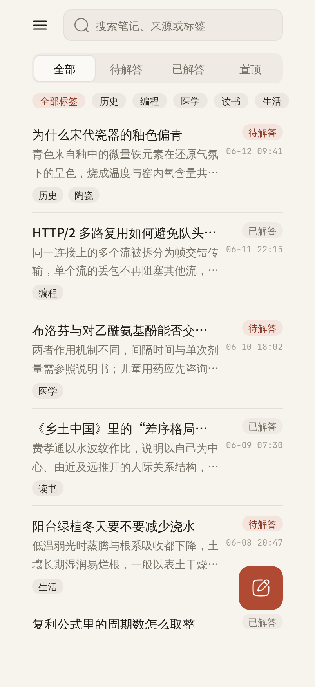
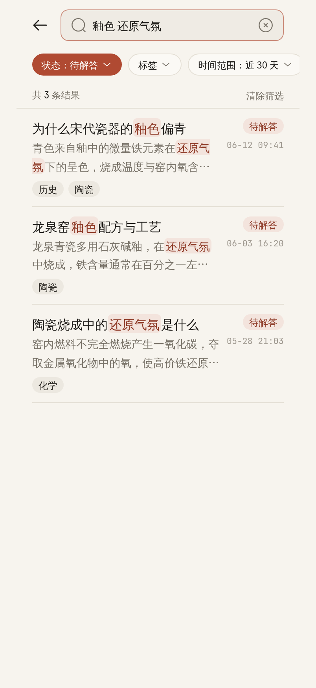
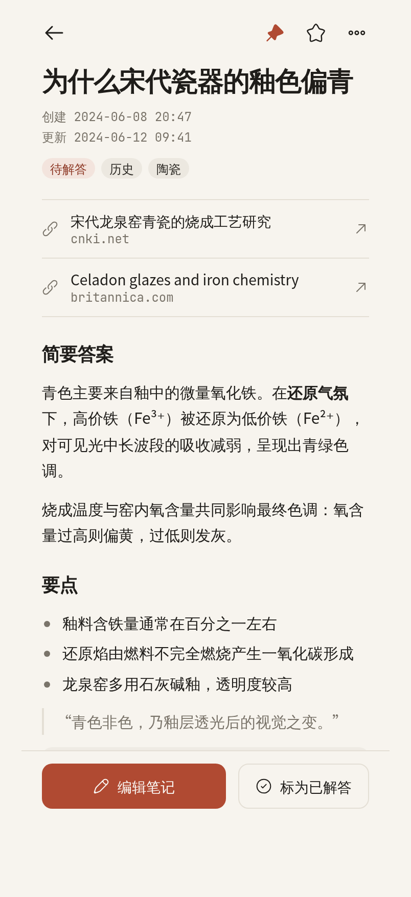
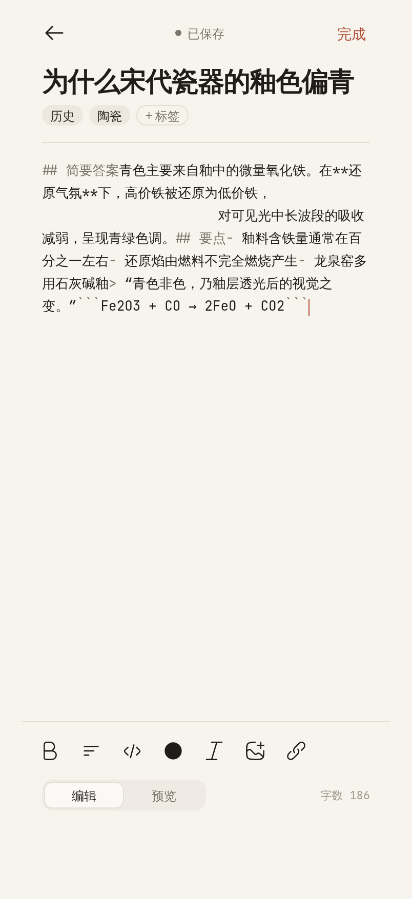
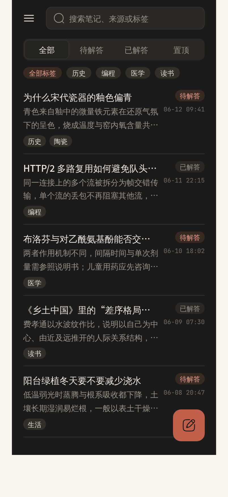

# 记问 JiWen

<p align="center">
  
</p>

<p align="center">一款完全离线的 Android 个人知识笔记应用，专注于「记录快、找得到、数据不丢」。</p>

<p align="center">
  
  
  
  
  
</p>

## 简介

记问是一款单人自用的本地知识库。它解决手机自带便签的三个问题：**不能搜索、不能分类、不能导出**。

所有笔记、标签、图片和备份都保存在应用私有目录中，应用不声明网络权限，也不依赖任何在线服务。核心价值排序为：记录快 > 找得到 > 数据不丢 > 好看。

## 界面

| 笔记列表 | 全文搜索 |
| --- | --- |
|  |  |
| 标题、摘要、标签、更新时间与「待解答 / 已解答」状态一屏可见，支持紧凑、标准、宽松三档密度。 | 支持中文子串搜索，命中片段高亮，并可组合标签、状态与时间范围筛选。 |

| 详情阅读 | Markdown 编辑 |
| --- | --- |
|  |  |
| 统一渲染管线，代码块可复制，长文使用 Sliver 懒加载，并提供 H1~H3 大纲跳转。 | 工具栏覆盖标题、列表、代码块、加粗、斜体、图片与链接，支持撤销重做和编辑 / 预览切换。 |

<p align="center">
  
  <br>
  深色模式
</p>

## 功能

| 模块 | 能力 |
| --- | --- |
| 记录 | 15 秒内完成一次记录；自动保存与进程被杀后的恢复；待解答 / 已解答状态；置顶与收藏 |
| Markdown | H1~H3、有序 / 无序列表、代码块（等宽字体、横向滚动、一键复制）、加粗、斜体、链接、图片插入与全屏查看 |
| 图片 | 相册选择或拍照，长边超过 1600px 自动压缩，删除笔记时清理无引用图片 |
| 标签 | 标签增删改查，一条笔记可挂多个标签，标签页显示笔记数，删除标签不影响笔记 |
| 检索 | 标题、正文、标签名全文搜索；中文词语中间截取也能命中；结果高亮；进入详情自动定位首个命中位置；最近 20 条搜索历史 |
| 筛选与排序 | 标签 + 状态 + 时间范围组合筛选；按最近修改、创建时间或标题排序 |
| 阅读 | 三档列表密度；笔记大纲（H1~H3 章节跳转与当前位置高亮）；深色模式；正文字号调节 |
| 数据安全 | 回收站保留 30 天；每日首次启动或累计 50 次修改自动备份，保留最近 5 份；手动备份与恢复 |
| 导入导出 | 单条笔记导出 Markdown；全部笔记导出 ZIP（含 `assets/` 图片）；JSON 全量备份与回导；粘贴文本按分隔符批量拆分导入；导入 `.txt` / `.md` 文件 |
| 隐私 | 4~6 位 PIN 应用锁，可启用指纹 / 面容解锁；超时自动锁定；锁定时禁止截屏与最近任务缩略图 |
| 其他 | 单条笔记 Markdown 分享；`[[标题]]` 内部链接跳转；统计面板（笔记总数、待解答数、标签分布） |

## 技术栈

| 层 | 选型 |
| --- | --- |
| 框架 | Flutter 3.47.9 / Dart 3.13.7，Material 3 |
| 存储 | `sqlite3` 本地数据库 + 应用私有目录文件存储 |
| 图片 | `image_picker`、`path_provider` |
| 导入导出 | `archive`（ZIP）、`file_picker`、`share_plus` |
| 安全 | `local_auth`（生物识别）、`crypto`、`flutter_secure_storage` 风格的本地 PIN 校验 |
| 其他 | `url_launcher`、`scrollable_positioned_list` |

Markdown 解析、渲染与编辑逻辑均为项目内自研实现，位于 `lib/util/` 与 `lib/widgets/`。

## 项目结构

```text
lib/
├── data/          # 数据库、设置、附件、备份、导入导出、应用锁
├── models/        # 笔记与标签模型
├── screens/       # 列表、详情、编辑、搜索、标签、回收站、统计、设置等页面
├── util/          # Markdown 解析与编辑、搜索高亮、文本导入、时间格式化
├── widgets/       # 列表项、标签、Markdown 视图、操作面板
└── theme.dart     # 共享配色与主题
test/              # Markdown、搜索高亮、数据工具等单元测试
design/            # 应用图标与 HTML 交互原型
docs/screenshots/  # README 截图
```

## 构建与运行

环境要求：Flutter 3.47.9（stable）、Dart 3.13.7、Android SDK 36、JDK 17+。

```bash
flutter pub get
flutter run                 # 调试运行
flutter test                # 单元测试
flutter build apk --release # 产物：build/app/outputs/flutter-apk/app-release.apk
```

安装包可从 [Releases](https://github.com/gyluq/JiWen/releases) 下载。当前 release 构建沿用 Flutter 模板的 debug 签名，适合自用侧载；如需上架应用商店，请配置自己的 keystore。

## 数据说明

- 数据库、图片与备份全部位于应用私有目录，卸载应用会一并清除，升级或卸载前请先导出备份。
- 应用未声明 `INTERNET` 权限，不包含账号、云同步或任何在线服务。
- 忘记 PIN 无法找回，只能重装后通过备份恢复。
